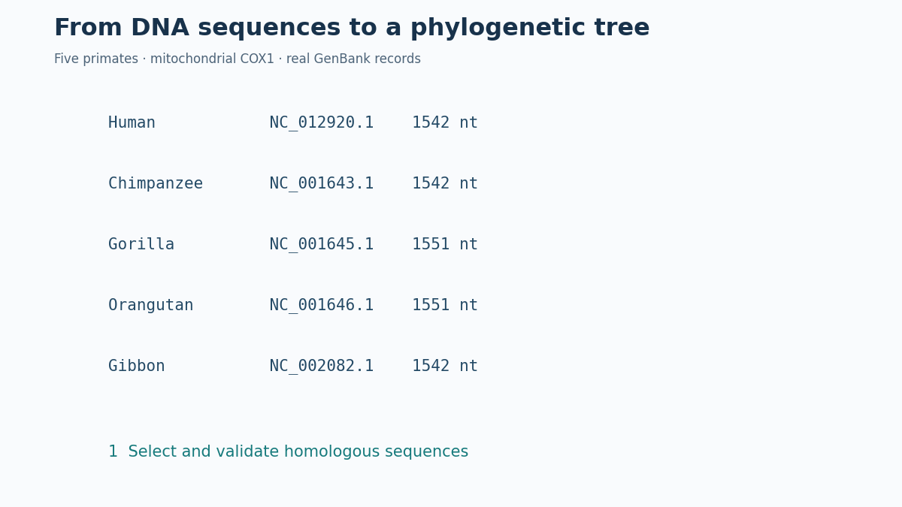
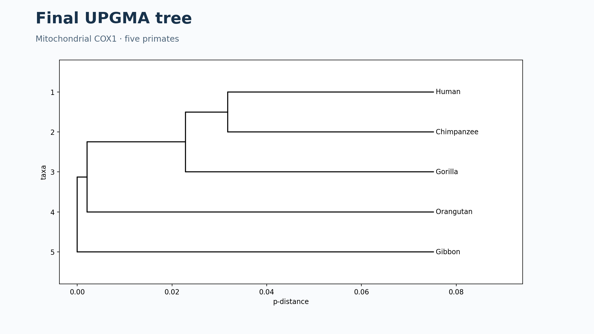

# De las secuencias de ADN al árbol filogenético: cinco primates

>Los resultados de esta página se han calculado a partir de cinco registros GenBank. El árbol representa la inferencia obtenida con **UPGMA** sobre el gen mitocondrial **COX1**; no es una demostración definitiva de la filogenia de especies.

## Objetivos

Comprender cómo se seleccionan secuencias homólogas, por qué se alinean, cómo se calcula una matriz de distancias genéticas y cómo UPGMA construye un árbol a partir de ella. Se muestran **todos los resultados calculados** y se proporcionan archivos para reproducirlos.

## 1. Selección de las secuencias reales

Elegimos el gen mitocondrial ortólogo **COX1** (citocromo c oxidasa, subunidad I) en cinco primates. Se recuperó la región `CDS` -*Coding Sequences*- anotada de cada registro GenBank, no un intervalo arbitrario del genoma.

| Especie | Accesión NCBI | Coordenadas CDS (1-based, inclusivas) | Longitud |
|---|---|---|---:|
| Humano (*Homo sapiens*) | [NC_012920.1](https://www.ncbi.nlm.nih.gov/nuccore/NC_012920.1) | 5904–7445 | 1542 nt |
| Chimpancé (*Pan troglodytes*) | [NC_001643.1](https://www.ncbi.nlm.nih.gov/nuccore/NC_001643.1) | 5321–6862 | 1542 nt |
| Gorila (*Gorilla gorilla*) | [NC_001645.1](https://www.ncbi.nlm.nih.gov/nuccore/NC_001645.1) | 5325–6875 | 1551 nt |
| Orangután (*Pongo pygmaeus*) | [NC_001646.1](https://www.ncbi.nlm.nih.gov/nuccore/NC_001646.1) | 5332–6882 | 1551 nt |
| Gibón (*Hylobates lar*) | [NC_002082.1](https://www.ncbi.nlm.nih.gov/nuccore/NC_002082.1) | 5322–6863 | 1542 nt |

**Reproducibilidad: Visualización en navegador** los registros originales se conservan en
`genbank/`, las CDS extraídas en
<a href="secuencias-cox1.txt" target="_blank" rel="noopener noreferrer">secuencias-cox1.fasta</a>
y los metadatos en
<a href="validacion-cox1.txt" target="_blank" rel="noopener noreferrer">validacion-cox1.csv</a>.

**Reproducibilidad: Descargas en equipo** los registros originales se conservan en
`genbank/`, las CDS extraídas en
<a href="secuencias-cox1.fasta" target="_blank" rel="noopener noreferrer">secuencias-cox1.fasta</a>
y los metadatos en
<a href="validacion-cox1.csv" target="_blank" rel="noopener noreferrer">validacion-cox1.csv</a>.

## 2. Validación de las secuencias

Comprobamos de forma automática que los cinco registros tienen la accesión y la especie esperadas; que contienen exactamente una `CDS` etiquetada `COX1`; que la extracción respeta la orientación de la anotación; que las secuencias solo contienen `A`, `C`, `G` y `T`; y que la traducción con el **código mitocondrial de vertebrados (tabla 2)** no contiene codones de parada internos.

**Resultados:** cinco CDS válidas para estas comprobaciones, ninguna base `N`, ninguna parada interna; todas las CDS están anotadas en la hebra positiva. Las diferencias de longitud (1542 frente a 1551 nt) hacen necesario el alineamiento. Estas comprobaciones no sustituyen una revisión filogenética exhaustiva de ortología, calidad de ensamblaje y posible sesgo de secuencia.

## 3. Alineamiento y cálculo de distancias

Realizamos un **alineamiento global progresivo anclado a la secuencia humana**: cada CDS se alineó globalmente frente a la humana y las inserciones respecto a esa referencia se incorporaron en columnas comunes. Se utilizó `Bio.Align.PairwiseAligner` con puntuaciones `match=2`, `mismatch=-1`, apertura de hueco `-6` y extensión `-0.5`. Es un procedimiento reproducible y apropiado para estas secuencias próximas, **pero no equivale a ejecutar MAFFT o Clustal Omega**. Para un estudio de investigación convendría contrastarlo con un alineamiento codón-consciente.

El alineamiento resultante contiene **1560 columnas**. Se comprobó que, al eliminar los huecos de cada secuencia alineada, se recupera exactamente la CDS original. Archivo: [`alineamiento-cox1.fasta`](alineamiento-cox1.fasta).

Para cada pareja de especies se calculó la <strong>distancia p</strong>:

  pij =
  
    
      Número de nucleótidos diferentes
    
    
      Número de posiciones comparables
    
  

Las posiciones con huecos o caracteres distintos de `A/C/G/T` se excluyeron **por pareja**. Por ello el denominador puede variar entre comparaciones. La distancia p mide diferencias observadas; no corrige sustituciones múltiples ni debe interpretarse automáticamente como tiempo evolutivo.

### Matriz de distancias p (calculada)

| Especie | Humano | Chimpancé | Gorila | Orangután | Gibón |
|---|---:|---:|---:|---:|---:|
| Humano | 0.00000 | 0.10895 | 0.14462 | 0.10052 | 0.15110 |
| Chimpancé | 0.10895 | 0.00000 | 0.14916 | 0.08690 | 0.14462 |
| Gorila | 0.14462 | 0.14916 | 0.00000 | 0.15499 | 0.15305 |
| Orangután | 0.10052 | 0.08690 | 0.15499 | 0.00000 | 0.14332 |
| Gibón | 0.15110 | 0.14462 | 0.15305 | 0.14332 | 0.00000 |

**Ejemplo de cálculo con los datos reales:** humano–chimpancé: **134 diferencias / 1542 posiciones comparables = 0.08690**. Los diez recuentos se encuentran en [`diferencias.csv`](diferencias.csv).

## 4. Construcción del árbol con UPGMA

UPGMA une en cada iteración los dos grupos con menor distancia y actualiza las distancias al resto mediante la **media ponderada por el número de secuencias**:

  d(A ∪ B, C) =
  
    
      |A| · d(A,C) + |B| · d(B,C)
    
    
      |A| + |B|
    
  

La altura del nuevo nodo es `d(A,B)/2`; cada longitud de rama se obtiene restando la altura del nodo hijo a la del padre.

| Iteración | Grupos unidos | Distancia | Altura del nodo | Grupo resultante |
|---|---|---:|---:|---|
| 1 | Humano + Chimpancé | 0.08690 | 0.04345 | G1 |
| 2 | Humano,Chimpancé + Gorila | 0.10473 | 0.05237 | G2 |
| 3 | Humano,Chimpancé,Gorila + Orangután | 0.14635 | 0.07317 | G3 |
| 4 | Humano,Chimpancé,Gorila,Orangután + Gibón | 0.15045 | 0.07523 | G4 |

**Actualización real de la primera fusión:** se unen humano y chimpancé; las nuevas distancias del grupo `{humano, chimpancé}` son:

- A *Gorilla gorilla*: **0.10473**.
- A *Pongo pygmaeus*: **0.14397**.
- A *Hylobates lar*: **0.15208**.

Las matrices de cada iteración están almacenadas en [`resultados.json`](resultados.json) y el historial completo de fusiones en [`iteraciones-upgma.csv`](iteraciones-upgma.csv).

El árbol final se encuentra también en formato [Newick](arbol-upgma.nwk). Se comprobó que todas sus hojas tienen la misma distancia a la raíz (característica de UPGMA).

## 5. Interpretación y limitaciones

En este ejemplo, **humano y chimpancé** se agrupan primero; después se incorpora el gorila, luego el orangután y por último el gibón. Esta es la **topología inferida a partir de estas secuencias y de este procedimiento**. No implica que una especie actual sea ancestro de otra. Los nodos representan ancestros comunes inferidos y las ramas están medidas en unidades de distancia p, no en años.

UPGMA supone una **tasa evolutiva aproximadamente constante** (reloj molecular estricto). El árbol UPGMA es ultramétrico por construcción; **esto no demuestra que los datos satisfagan el supuesto del reloj molecular**. Además, un único gen mitocondrial describe una historia genética particular, no necesariamente toda la historia de las especies. Para inferencias robustas deben considerarse más genes, modelos de sustitución, métodos alternativos y soporte estadístico.

## 6. Para reflexionar

- ¿Por qué no se comparan genes distintos?  
- ¿Por qué las CDS tienen diferentes longitudes?
- ¿Qué significa `p = 0,08690` para humano y chimpancé?
- ¿Por qué cambian las distancias al formar un grupo?
- ¿Qué supuesto introduce UPGMA y qué limitaciones tiene un árbol basado en un solo gen?

## 7. Reproducibilidad y materiales

Los archivos GenBank de entrada están en `genbank/`. Para reproducir los resultados se requiere Python 3 con `biopython`, `matplotlib`, `numpy` y `pillow`. Ejecutar desde la carpeta del proyecto `python procesar_datos.py` y luego `python generar_animacion.py`. No es necesario ejecutar nada para **visualizar** el Markdown, la figura y el GIF publicados en GitHub Pages.

**Trazabilidad:** [`validacion-cox1.csv`](validacion-cox1.csv) · [`secuencias-cox1.fasta`](secuencias-cox1.fasta) · [`alineamiento-cox1.fasta`](alineamiento-cox1.fasta) · [`diferencias.csv`](diferencias.csv) · [`distancias.csv`](distancias.csv) · [`iteraciones-upgma.csv`](iteraciones-upgma.csv) · [`resultados.json`](resultados.json) · [`arbol-upgma.nwk`](arbol-upgma.nwk).

**Referencias:** [NCBI Nucleotide](https://www.ncbi.nlm.nih.gov/nuccore/), [Biopython](https://biopython.org/), [MAFFT](https://mafft.cbrc.jp/alignment/software/), [GitHub Pages](https://docs.github.com/en/pages).
